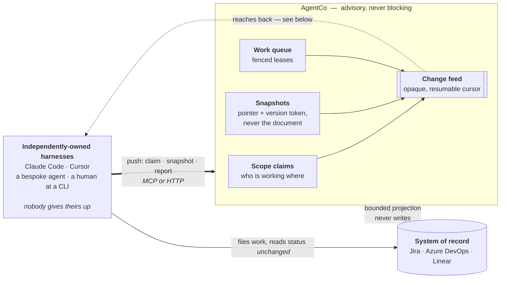
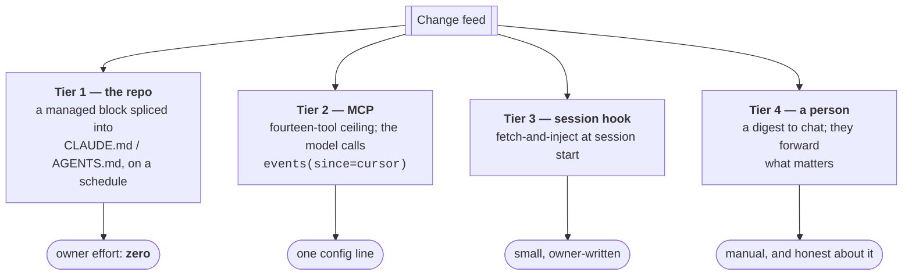

# AgentCo

**A coordination layer for organisations running more than one agentic harness.**

Everyone on your team is running their own AI coding agent. Different tools, different
vendors, no two configured the same — and nobody is giving theirs up. Individually they
work fine. Together they are blind to each other:

- Two agents edit the same directory and nobody finds out until the merge.
- One builds against a spec that changed last Tuesday.
- An agent hits something it cannot decide, asks a human, and the question goes nowhere —
  because nothing guaranteed it was delivered.

AgentCo holds the three things nothing else holds: **the claims people and agents make
about each other's work**, **the pointers you built against, so you are told when they
move**, and **a router that puts a decision in front of a named human and records the
acknowledgement**.

*New here, or explaining it to someone else? [`docs/ecosystem.md`](docs/ecosystem.md) is the seven-minute version: the problem, what a hub holds, what a harness does, and what counts as this working.*

The organizing idea is the **ASOP — Agentic Standard Operating Procedure**
([full definition](docs/asop.md)): a procedure that is **versioned** (outcomes
recorded per version, never per vibe), **verified** (it carries its own definition
of done — a deterministic check, a fixed rubric, or a named human's sign-off,
enforced where completion is recorded so no executor grades its own homework), and
**self-revising** (plan-vs-actual divergence feeds the next version instead of a
postmortem nobody reads). *An SOP tells an agent what to do; an ASOP can prove it
was done and gets better when it wasn't.* AgentCo is the plane that stores ASOPs,
versions them, records their outcomes, and routes their human gates — whatever
work-unit your harness uses to execute them (ours is called a bead).

The gate schema and the SOP record shape that make "verified" and
"versioned" checkable are their own package, `asop-spec`
([`asop-spec`](https://github.com/mabidoli/asop)) — the one piece any harness executing
ASOP work needs, without needing the rest of this coordination plane. This
repo depends on it like any other consumer; see
[`docs/architecture.md`](docs/architecture.md#the-asop-contract-package).

It sits **above** agent memory and context stores — an agent's own recall is its
harness's business (that layer is well served by projects like
[OpenViking](https://github.com/volcengine/OpenViking)); AgentCo coordinates what
happens **between** agents and the people who own them. Lessons shared between
agents belong to that "between" — owner-labeled, judged by use, and being built in
slices **behind a switch that is off by default, and experimental in version 1** (`AGENTCO_MEMORY=on`; design:
[`docs/decisions/0006-hub-memory-design.md`](docs/decisions/0006-hub-memory-design.md),
what is built: [`docs/memory.md`](docs/memory.md)).
Likewise it is not a personal-AI framework: projects like [LifeOS](https://github.com/danielmiessler/LifeOS) run *one*
principal's assistant superbly — AgentCo is the layer they plug into the moment an
organisation runs more than one.

## How it works



Everyone keeps their own harness. The system of record stays authoritative — AgentCo
holds only the things nothing else does, and if it disappears every tool falls back to
exactly what it does today.

### Getting information back to a harness

Nothing can *push* into a model's context; a harness assembles that itself, at turn
boundaries. So reaching one is always one of three moves — write into a file it already
reads, give the model a reason to ask, or tell the human.



**Tier 1 is the only one that reaches a harness nobody configured**, which is the premise
of the project. It is also the one that has to be careful, because it edits a file in
somebody else's repository: the splice reads and writes bytes, matches the file's own line
endings, never touches a byte outside its markers, never creates a file that does not
exist, and is dry-run by default.

Tiers 1 and 3 also carry *the instruction to pull* — which is what stops tier 2 being a
tool the model has to remember on its own.

That diagram is the read direction. Writing back had the same problem until recently: every
verb that mattered sat behind tier 2's one config line, so a harness that configured nothing
could read the splice and do nothing with it — an audience, not a participant. A harness at
that level is now **L1**: it publishes by appending a line to `.agentco/outbox.jsonl`, no
config and no credential needed on its side, and a local drainer signs and delivers it. See
[`docs/participation.md`](docs/participation.md) for what to run at each level,
[`docs/outbox.md`](docs/outbox.md) for the L1 path in full, and the
[participation-ladder ADR](docs/decisions/0002-participation-ladder.md) for why the
ladder has these rungs.

## What it is not

**It is not your system of record.** Jira, Azure DevOps, Linear and GitHub Issues stay
authoritative. AgentCo never becomes the place work lives, and it holds no competing
version of a fact another system owns.

There is exactly one path that reaches back the other way, and it is named here rather
than buried: an **opt-in write-back** ([`docs/writeback.md`](docs/writeback.md)) that can
tell the record a piece of work came from that its human gate is waiting. It is off
until configured, it carries a notice and nothing that could change a state or close a
ticket, and the built-in path POSTs to a URL you control — so the code that touches
Azure DevOps is yours, holding your credential. Absent that configuration the sentence
above holds without qualification, which is the only way a promise like it is worth
making.

**It never blocks anyone.** Scope claims are advisory. If AgentCo is down, every tool
falls back to exactly what it does today.

**It does not replace your harness.** Claude Code, Cursor, Copilot, Aider, a bespoke
in-house agent — keep all of them. Integration is one config entry, and nothing about
how your harness works changes.

## Status

**Early, and usable. Pre-release:** the package version is `0.1.0` (`pyproject.toml`, classifier
`Development Status :: 3 - Alpha`) and no release has been tagged. What counts as version 1 is
written down in [`docs/decisions/0011-v1-definition.md`](docs/decisions/0011-v1-definition.md): five
gates, of which "correct" and "contract settled" have passed, and "the loop closes", "docs match
code" and "released" have not. The coordination primitives are implemented and tested: scope
claims with conflict detection, snapshot pointers with divergence delivered at a cadence
boundary, a resumable change feed, a work queue with a fenced lease protocol proven across
twelve real processes, versioned ASOPs, an MCP surface, and both injection tiers. On top
of them, all three ASOP properties now have code behind them, at v3's grain — the ASOP
is a versioned SEQUENCE and the gate rides on each step, so a run files a tree of beads
and no filer authors its own check: gates with attestation (deterministic, judged, human
— with park clocks and a named verifier), the revision policy an agent cannot break
applied per step, adjudication with adjudicator ≠ executor enforced and who may
adjudicate declared, plan-vs-actual written per step at completion, the lessons pass
that drafts the next version, and `promote` turning a run that worked into a draft
procedure.
The L1 outbox reaches a harness that configured nothing, and a conformance suite
(`agentco conform --level`) holds HTTP, MCP and the outbox to one semantic core. See
[`docs/`](docs/) for the design, [`docs/roadmap.md`](docs/roadmap.md) for what is built
versus planned, and [`docs/known-issues.md`](docs/known-issues.md) for what is broken.

**What is tested, and on what.**

- **Python** 3.11, 3.12 and 3.13 (CI matrix).
- **`asop-spec`**, the contract package: the pin is `>=0.4.0,<1`, the lock is 0.6.1, and CI runs the
  suite against 0.4.0, 0.5.0, 0.6.0 and 0.6.1 (`.github/workflows/ci.yml`, job `contract`).
- **Storage**: JSONL under an advisory lock (the default), SQLite (`AGENTCO_DB=<path>`) and Postgres
  (`AGENTCO_DB=postgresql://...`, the optional `postgres` extra). One conformance suite runs on all
  three; the Postgres run needs a database and is its own CI job.
- **Experimental, outside the 1.0 promise:** shared memory (off unless `AGENTCO_MEMORY=on`) and
  everything under `/memory`.
- **Built, proven automatically, not yet run across two machines:** people's signed answers to human
  gates ([`docs/envelope.md`](docs/envelope.md)), with the person's side as `agentco partition`. Version 1
  gate 2 stays open until [the runbook](docs/runbooks/first-signed-answer-loop.md) has been run on two hosts.
- **Not built:** federation beyond one upstream digest, OIDC, a UI for views. See the roadmap.

The project's own adoption gate is written down and deliberately hard to game: **two
people other than the author publishing weekly for four consecutive weeks.** A person's
agents count once, for them — at two or three agents each, counting keys would have let
one adopter clear a two-publisher bar alone. Stars
are the vanity metric that will be available; weekly publishers are not. A public repo
with no users is a worse outcome than a private tool with two, because it looks like
adoption while being none.

## Design principles

These are load-bearing, and each was derived from a failure mode rather than from taste.

| Principle | Why |
|---|---|
| **Any tool may push. No tool may file.** | A push is a signal; the owning controller decides what becomes work — with a clock, because "I pushed and nothing happened" is the most adoption-lethal outcome available. |
| **Advisory, never blocking.** | Making concurrency visible is most of the value and none of the political cost — but only if it never stops anyone working. |
| **Pointers, never copies.** | Snapshots record a URI plus a cheap version token. No document body is ever stored. A second document store is how a coordination layer becomes a system of record by accident. |
| **Fail static.** | If the plane is down, nothing is blocked; it reconciles when it returns. |
| **Every refusal carries a remediation.** | A tool that refuses without saying what to do instead teaches people it is broken. |
| **Anything naming a company is configuration, not code.** | Which is what makes this repo publishable at all — see [CONTRIBUTING](CONTRIBUTING.md). |

## Getting started

Requires Python 3.11+ and [uv](https://docs.astral.sh/uv/).

```bash
git clone https://github.com/agentic-co/agentic-co-hub && cd agentic-co-hub
uv run --extra dev --extra server --extra mcp pytest -q
```

That installs `asop-spec` (the ASOP contract package) from PyPI into the project's virtual
environment. The contract's own suite runs in its own repository (https://github.com/mabidoli/asop).

A plain `python3 -m agentco` does not work in a fresh clone: `asop-spec` is not installed in the
system interpreter, which also may be older than 3.11. Run the commands below through `uv`. A shell
function keeps them short (set the path to your clone):

```bash
agentco() { uv run --project /path/to/agentic-co-hub --extra server --extra mcp python -m agentco "$@"; }
```

Every `agentco ...` line below assumes it.

### Run it

Point it at a directory for its state, mint a secret for yourself, and start the
service:

```bash
mkdir -p ~/.agentco && chmod 700 ~/.agentco
export AGENTCO_REGISTRY_DB=~/.agentco/registry.sqlite3
export AGENTCO_WORK_STORE=~/.agentco/work.jsonl
export AGENTCO_REGISTRY_KEYS=~/.agentco/keys.json
export ASOP_HUMANS=you               # the actors the revision policy exempts; everyone else is an agent
export ASOP_VERIFIERS=you            # routes that may answer judged/human gates; unset, NO route may and an attestation is 403 unauthenticated (declared humans still can)

agentco keygen you > ~/.agentco/keys.json && chmod 600 ~/.agentco/keys.json
agentco serve --port 8787                              # loopback by default; leave it running
agentco conform --level L2                             # in another shell: the transports you rely on are the core, or it says what differs
```

Or in Docker — one container, state on a named volume, port published to
loopback only:

```bash
agentco keygen you > keys.json && chmod 600 keys.json
docker compose up -d --build registry
```

See [`docs/docker.md`](docs/docker.md) for what the image mounts and why, how to declare
`ASOP_HUMANS` and `ASOP_VERIFIERS` for the container, the cadence job, and why the MCP surface is
deliberately not containerised.

Running several separate hubs (one per client, plus a personal one), walled from each other: [`docs/runbooks/run-several-hubs.md`](docs/runbooks/run-several-hubs.md).

### Publish something

`agentco/publish.py` is standard-library only and meant to be copied next to
whatever you already run. No install required on the calling side.

```python
from agentco.publish import Registry

reg = Registry("you", SECRET, "http://127.0.0.1:8787")   # SECRET is your entry in keys.json

# "I am about to work in these directories." Advisory — it blocks nobody.
lease = reg.claim_scope("acme/web-platform", ["src/billing/invoices"], "implement")
for c in lease["conflicts"]:
    print(f"{c['withHolder']} is already in there, intent={c['theirIntent']}")

# "I am working from this version of that." The document is never fetched or stored.
# A `git:` pointer is recorded but not followed until the operator adds `git` to
# ASOP_SNAPSHOT_SCHEMES (the default is http and https); the receipt says so.
reg.snapshot("git:/path/to/repo#main", "baseline for the redesign")

# Catch up on everything since your last cursor.
feed = reg.events()
```

### Connect a harness

One entry in your `.mcp.json`, and nothing about how your harness works changes:

```json
{
  "mcpServers": {
    "agentco": {
      "command": "uv",
      "args": ["run", "--project", "/path/to/agentic-co-hub", "--extra", "mcp",
               "python", "-m", "agentco", "serve-mcp"],
      "env": {
        "AGENTCO_ACTOR": "you",
        "AGENTCO_REGISTRY_DB": "/path/to/registry.sqlite3",
        "AGENTCO_WORK_STORE": "/path/to/work.jsonl",
        "AGENTCO_SOP_STORE": "/path/to/sops.jsonl"
      }
    }
  }
}
```

Fourteen tools, and fourteen is a ceiling enforced by a test rather than
remembered — a large tool surface costs every calling harness context on
every tool-choice decision it makes. All fourteen are built, so the ceiling
is binding. A byte budget over the registered schemas is published alongside
the count (`tests/test_mcp_server.py`), because the count is a stand-in for
context cost, not the thing itself, and a ceiling that holds while the bytes
behind it grow has stopped measuring what it was chosen to measure. ASOP v3
added seven verbs to the HTTP surface;
[`docs/decisions/0004-mcp-surface-under-asop-v3.md`](docs/decisions/0004-mcp-surface-under-asop-v3.md)
(option C) put the two a harness performs in its own loop — `sop_run` and
`adjudicate` — on MCP and left the five operator verbs on HTTP. The budget
is 14,000 bytes; the fourteen schemas measure 13,497. A refusal over MCP
carries its `code` as a field (`structuredContent`, the same body HTTP
returns) beside the familiar `code: message — remediation` text.

That entry points the harness at **local files**, which is right when the
harness and the registry share a disk. When they do not — a second machine, a
container, a colleague's laptop — the same primitives are on the HTTP surface,
and `publish.py` speaks it:

```python
reg = Registry("macbook", SECRET, "http://registry.example.com:8787")

pulled = reg.work_pull()                      # fenced lease, or state="empty"
if pulled["state"] == "leased":
    item = pulled["item"]
    reg.work_report(item["id"], pulled["attempt"], "done", result="…")

# Filing work from a procedure files a TREE — one bead per step, each carrying
# its step's own gate. No gate is sent: the version already has one.
run = reg.sop_run(asop_id, inputs={"requirement": "REQ-1"},
                  bindings={"implementer": "macbook", "validator": "reviewer"})["run"]

# A lesson learned on one machine, active for every reader on the next call.
# It lands on the STEP that earned it, which is what makes "did this help" a
# per-step count rather than a per-procedure one.
reg.sop_revise(asop_id, steps=[{**step, "common_mistakes": ["Report with the attempt from work_pull"]}])
reg.sop_activate(asop_id, 2)
```

`bindings` is required and never guessed. An ASOP names *roles*, never agents —
that is what lets two organisations run the same version and still count their
outcomes against the same thing — so which agent fills `validator` is a fact
about your harness, and a role with no binding is refused rather than filled in.

The revision calls are policed when the caller is an agent — that is, any actor
not named in `AGENTCO_HUMANS`. A step tagged `money` or `irreversible` is frozen
against agents, a step's class only ratchets toward `human`, and no agent
revision undoes a change a human made. `retire` and `promote` are human-only
outright. [`ASOP.md`](https://github.com/mabidoli/asop/blob/main/ASOP.md) § 6.4 has the rules;
`agentco/policy.py` enforces them, and a refusal comes back as HTTP 403
`revision_policy:<rule>`.

The claiming identity is the **authenticated actor**, never a field in the
body — a worker that can name itself can take another worker's lease, and the
fence would faithfully record the theft as legitimate. Send `attempt` back with
every report: a report that arrives after the lease moved is refused as
*superseded* rather than overwriting whoever holds the item now.

### Reach a harness nobody configured

The above is pull-only: the model asks, AgentCo answers. To reach an agent whose
owner has done nothing at all, write into a file it already reads.

```bash
# Splice live scope claims into the repo's agent-context file. Dry run first.
agentco inject CLAUDE.md AGENTS.md --repo acme/web-platform
agentco inject CLAUDE.md AGENTS.md --repo acme/web-platform --write

# Or, per person rather than per repo: a session-start hook.
agentco hook install ~/.claude/settings.json --write
```

`inject` writes a marker-delimited block and touches nothing outside it,
preserving the file's own line endings. `hook` takes a verbatim backup so
`uninstall` restores the original bytes exactly.

### Read the honest numbers

```bash
agentco metrics        # weekly publishers, latency, conflict precision
agentco gate1          # exit 0 iff the adoption gate is met (1 until two people have published for four weeks)
agentco pulse          # the plane checks itself and every actor wired to it; dry run
agentco pulse --apply --every 15m   # the scheduled form: sweeps, records, exit = worst class
agentco partition pending          # a person's side: pull the gates assigned to you (also keygen, pin, answer, receipt)
```

`pulse` is the heartbeat, inverted: the plane runs no cycles, so instead of proving
one ran it reads the traffic it already sees and says who has gone quiet. Exit 0 is
ok, 1 is attention, 2 means the plane itself cannot be trusted — never a count. Its
own silence is a finding too. See [`docs/pulse.md`](docs/pulse.md).

### Before you rely on it

Read [`docs/known-issues.md`](docs/known-issues.md). It lists every finding of the adversarial
reviews with its status, and what is accepted rather than fixed, with the test that pins it. Being
told what is broken is the point; a project this young that claims none would be lying.

## Licence

[Apache License 2.0](LICENSE). Apache rather than MIT for the explicit patent grant,
which matters when the thing being adopted is infrastructure inside a company.

Copyright 2026 The AgentCo Authors.
